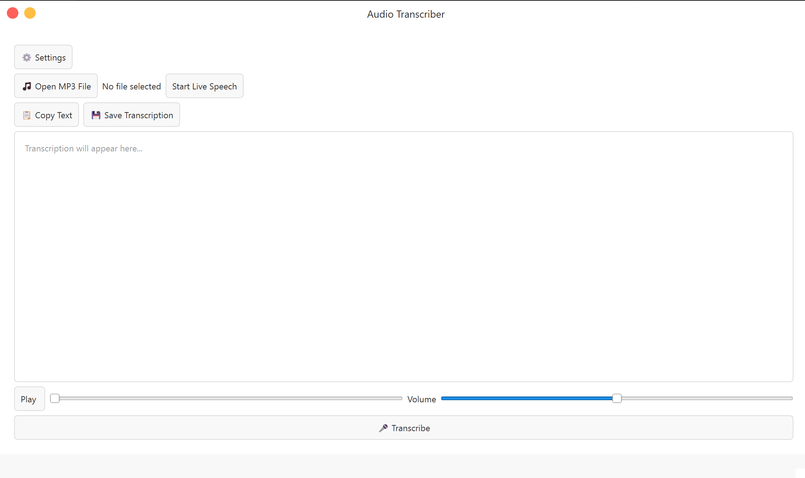
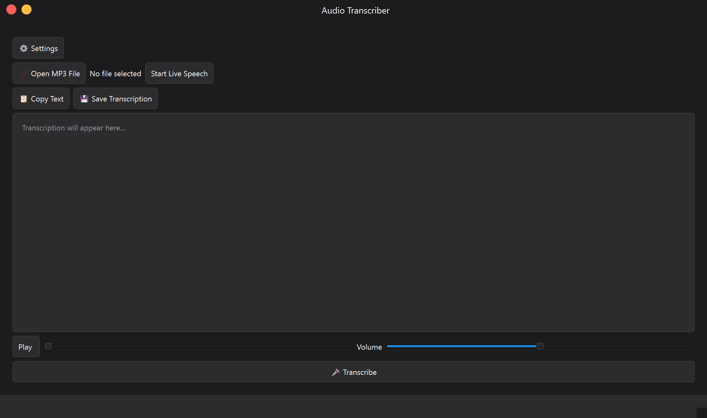

# Audio Transcriber App
A desktop application for transcribing audio files (MP3) to text using speech recognition, with additional live speech-to-text functionality.


<div style="display: flex; justify-content: space-between;">
  
  
</div>

## Features

- **Audio Transcription**: Convert MP3 files to text using Google's speech recognition API
- **Live Speech-to-Text**: Real-time transcription from microphone input
- **Customizable UI**: Light and dark mode support
- **Audio Playback Controls**: Play, pause, volume control, and mute functionality
- **Text Manipulation**:
  - Highlight important sections
  - Find text within transcriptions
  - Copy and save transcriptions
- **Keyboard Shortcuts**: Quick access to all major functions
- **Modern UI**: Custom title bar with window controls
- **Cross-platform**: Works on Windows, macOS, and Linux

## Requirements

- Python 3.7+
- PySide6
- SpeechRecognition
- pydub
- ffmpeg (for audio conversion)

## Installation

1. Install the required dependencies:
```bash
pip install PySide6 SpeechRecognition pydub
```

2. Install ffmpeg:
- On macOS: `brew install ffmpeg`
- On Linux: `sudo apt install ffmpeg`
- On Windows: Download from [ffmpeg.org](https://ffmpeg.org/)

3. Run the application:
```bash
python audio_transcriber.py
```

## Usage

1. **Open an MP3 file**: Click "Open MP3 File" or use Ctrl+O
2. **Transcribe**: Click the "Transcribe" button or use Ctrl+T
3. **Live Speech**: Click "Start Live Speech" to begin real-time transcription from your microphone
4. **Text Manipulation**:
   - Highlight text with Ctrl+H
   - Remove highlights with Ctrl+J
   - Find text with Ctrl+F
5. **Audio Controls**:
   - Play/Pause with Ctrl+B
   - Mute/Unmute with Ctrl+M
   - Adjust volume with the slider

## Keyboard Shortcuts

| Shortcut        | Action                          |
|-----------------|---------------------------------|
| Ctrl+O          | Open MP3 file                   |
| Ctrl+S          | Save transcription              |
| Ctrl+F          | Find text                       |
| Ctrl+M          | Mute/Unmute audio               |
| Ctrl+P          | Print transcription             |
| Ctrl+B          | Play/Pause audio                |
| Ctrl+T          | Transcribe                      |
| Ctrl+G          | Toggle Settings                 |
| Ctrl+Shift+C    | Copy All Text                   |
| Ctrl+H          | Highlight selection             |
| Ctrl+J          | Remove highlight                |

## Settings

Access settings via the ⚙️ button or Ctrl+G to:
- Toggle between light/dark mode
- Enable/disable live speech-to-text
- View all keyboard shortcuts

## Troubleshooting

- If you get audio-related errors, ensure ffmpeg is properly installed
- For microphone issues, check your system audio settings
- Live speech-to-text requires an active internet connection

## License

This project is open-source and available under the MIT License.

---

**Note**: This application uses Google's speech recognition API which requires an internet connection. For offline use, consider using a different speech recognition engine.
